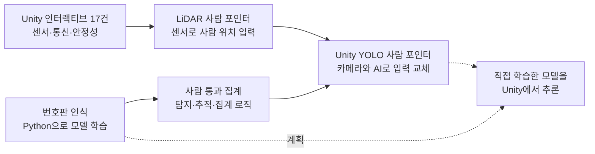
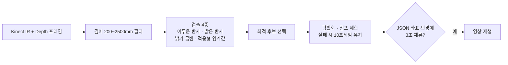
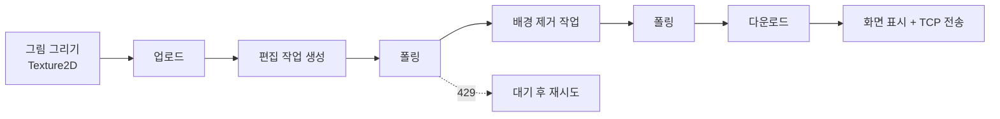
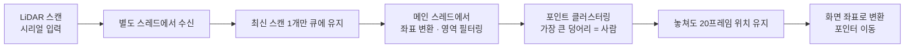

# 🧑‍💻 하정우 포트폴리오 — Unity 인터랙티브 · 컴퓨터 비전 · Unity와 AI

> 센서·통신·영상이 **현장에서 멈추지 않게** 만드는 Unity 개발자입니다.
> 센서 입력부터 AI 모델 추론까지, 하나의 시스템으로 연결하는 일을 합니다.

       

---

## 🗂️ 한눈에 보기

| 분류 | 프로젝트 | 핵심 | 보기 |
|---|---|---|---|
| **Unity 인터랙티브** | 17. 라이다 사람 포인터 | LiDAR 스캔으로 사람 위치를 찾아 화면 포인터로 변환 | [17-라이다-사람-포인터](17-라이다-사람-포인터) |
| **Unity 인터랙티브** | 전시·체험 콘텐츠 17건 | Kinect·LiDAR·Arduino 센서, TCP·REST 연동, 끊겨도 멈추지 않는 구조 | 이 저장소 [01~17 폴더](#-전체-프로젝트) · [대표 작업](#-대표-작업-4가지) |
| **컴퓨터 비전 (ML)** | 자동차 번호판 인식 | YOLOv8n 직접 학습(테스트 mAP50 0.871), EasyOCR, 형식 검증·다수결 | [python_numberPlate](https://github.com/jay-7314/python_numberPlate) |
| **컴퓨터 비전 (ML)** | 사람 통과 인원 집계 | YOLO 탐지·추적, 기준선 통과 방향별 In/Out 집계 | [python_TrackPeople](https://github.com/jay-7314/python_TrackPeople) |
| **Unity와 AI** | Unity YOLO 사람 포인터 | ONNX 모델을 Unity에서 직접 추론, 추론 6.4ms · 인식 31회/초 | [unity-yolo-person-pointer](https://github.com/jay-7314/unity-yolo-person-pointer) |

## 🧭 프로젝트들이 이어지는 흐름



센서로 하던 사람 인식을 카메라와 AI 모델로 바꿔 가며, **Unity 현장 구현 + 비전/ML + 둘을 잇는 배포**까지 범위를 넓히고 있습니다.
진행 상황은 [진행기록](진행기록.md)에 날짜별로 남깁니다.

---

## 🎮 Unity 인터랙티브 콘텐츠 (이 저장소의 01~17 폴더)

**이 저장소의 Unity 코드는 열람용입니다.** 영상·이미지·오디오, 서드파티 에셋(OpenCV+Unity, Kinect SDK 래퍼, DOTween 등), 내부 IP·키·기기 식별자는 제외하거나 가렸습니다. 그래서 이 저장소만으로 Unity 빌드는 되지 않습니다.
전시/체험형 인터랙티브 콘텐츠 17건이며, 그중 영상 선택형 키오스크 5건(09~13)은 같은 템플릿 기반입니다.

## ✨ 대표 작업 4가지

### 1. Kinect 적외선·깊이 카메라로 위치 추적 → [`14-키넥트-IR-추적`](14-키넥트-IR-추적/Assets/Scripts/)

반사 스티커를 든 위치를 Kinect v2(512×424)로 찾고, **정해진 자리에 3초 머물면** 해당 영상을 재생합니다.



- 제공받은 네이티브 플러그인을 `DllImport`로 호출하고, `GCHandle`로 배열을 고정해 복사 없이 프레임을 받습니다.
- 현장 조명이 바뀌어도 대응할 수 있게 검출 임계값을 인스펙터 슬라이더로 열어 두었습니다.

### 2. REST API로 서버와 이어지는 2인 퀴즈 게임 → [`02-REST-API-퀴즈게임`](02-REST-API-퀴즈게임/Assets/Scripts/Common/NetworkManager.cs)

서버의 방 상태(`USING`/`EMPTY`)를 폴링해 두 사용자를 연결하고, 입장·퇴장·시간·답안을 API로 기록합니다.

- 요청마다 타임아웃 10초, 실패하면 5초 뒤 재시도
- Newtonsoft.Json으로 컬럼 형태 응답을 파싱해 모델로 변환
- 공 오브젝트 풀링, 문항·팝업 텍스트는 JSON으로 분리

### 3. 외부 AI API 연동 그림 생성 → [`03-AI-그림-파이프라인`](03-AI-그림-파이프라인/Assets/Scripts/DrawingMatching.cs)

관람객이 그린 그림을 AI 서비스에 보내 편집·배경 제거를 거친 결과를 화면과 네트워크로 전달합니다.



### 4. LiDAR로 사람을 인식해 화면 포인터로 → [`17-라이다-사람-포인터`](17-라이다-사람-포인터/스크립트/라이다/CLidarManager.cs)

2D LiDAR(YDLIDAR) 스캔으로 공간 안의 사람 위치를 찾고, 그 위치를 대형 화면의 **포인터(마우스 커서 역할)** 로 사용합니다.



- 센서 수신은 백그라운드 스레드, Unity 오브젝트 접근은 메인 스레드에서만 하도록 나눴습니다.
- 큐에 쌓인 이전 스캔은 버리고 최신 값만 써서 화면이 센서보다 늦어지지 않게 했습니다.
- 포트와 최소·최대 감지 거리는 JSON으로 분리해 현장에서 빌드 없이 조정합니다.
- 제조사 SDK는 제외했으며, 이 폴더에는 직접 작성한 입력 모듈만 있습니다.

---

## 🛡️ 현장에서 안 멈추게 하는 방법 (공통 설계)

| 문제 | 해결 | 예시 |
|---|---|---|
| 통신이 중간에 끊긴다 | 자동 재접속·재시도 | TCP 2초 루프, Serial 3초 재연결, REST 5초 재시도 |
| 입력을 읽다가 화면이 끊긴다 | 백그라운드 스레드가 읽고 큐로 넘김, 메인 스레드에서 이벤트 발생 | [`ArduinoManager.cs`](01-아두이노-TCP-인터랙션/Assets/Scripts/Common/ArduinoManager.cs) |
| 현장에서 문구·좌표를 바꿔야 한다 | JSON으로 분리해 재빌드 없이 수정 | 전 프로젝트 `StreamingAssets/*.json` |
| 사람이 떠나면 화면이 남는다 | 유휴 타이머로 처음 화면 복귀 | 01, 07, 15, 16 |
| 원격으로 상태를 알고 싶다 | HTTP 로그 전송 + 인게임 로그 뷰어 | 03, 06 |

```csharp
// 백그라운드에서 쌓은 메시지를 메인 스레드에서만 꺼내 이벤트로 전달
while (messageQueue.TryDequeue(out string msg)) OnArduinoMsg?.Invoke(msg);
```

---

## 📂 전체 프로젝트

| # | 프로젝트 | 핵심 기술 |
|---|---|---|
| 01 | [아두이노 TCP 인터랙션](01-아두이노-TCP-인터랙션) | TCP 클라이언트(재접속·핸드셰이크), Arduino 시리얼(스레드+큐), JSON 설정 |
| 02 | [REST API 퀴즈게임](02-REST-API-퀴즈게임) | REST(타임아웃·재시도·폴링), Newtonsoft.Json, 오브젝트 풀링 |
| 03 | [AI 그림 파이프라인](03-AI-그림-파이프라인) | 텍스처 드로잉, 외부 AI API 파이프라인, 429 재시도, TCP 이미지 전송 |
| 04 | [웹캠 사운드 트리거](04-웹캠-사운드-트리거) | WebCamTexture 22개 지점 밝기로 터치 감지 |
| 05 | [웹캠 사진 합성](05-웹캠-사진-합성) | 웹캠 회전·반전, 타원 크롭, 사진 합성 |
| 06 | [터치 영상 지도](06-터치-영상-지도) | VideoPlayer 상태 관리, JSON 레이아웃, 원격 로그 |
| 07 | [아두이노 영상 퀴즈](07-아두이노-영상-퀴즈) | 영상 상태머신 퀴즈, Arduino 입력, 유휴 타이머 |
| 08 | [마이크 녹음 재생](08-마이크-녹음-재생) | Microphone 녹음·재생, 영상 동기화 |
| 09~13 | 영상선택 키오스크 A~E | 영상 선택형 키오스크 5건 (공통 템플릿) |
| 14 | [키넥트 IR 추적](14-키넥트-IR-추적) | Kinect IR·깊이, 위치 추적, 체류 판정 |
| 15 | [RFID 카드 퀴즈](15-RFID-카드-퀴즈) | RFID 시리얼(자동 재연결), DOTween 카드 뒤집기 |
| 16 | [듀얼디스플레이 국가선택](16-듀얼디스플레이-국가선택) | 듀얼 디스플레이, JSON UI 배치, 국가별 현지 시각·시차 |
| 17 | [라이다 사람 포인터](17-라이다-사람-포인터) | LiDAR 사람 인식 → 화면 포인터 (스레드 분리, 클러스터링, 추적 유지) |

**공통 구조** `GameManager`(싱글톤) · `JsonManager`(StreamingAssets JSON 로드) · `LoadManager`(리소스 로더) · `CoroutineData`

---

---


## 🙋 About

- **이름**: 하정우
- **이메일**: hjh268100@gmail.com
- **전화번호**: 010-2936-7314
- **경력**: Unity 개발 1년 3개월 (인터랙티브 콘텐츠)
